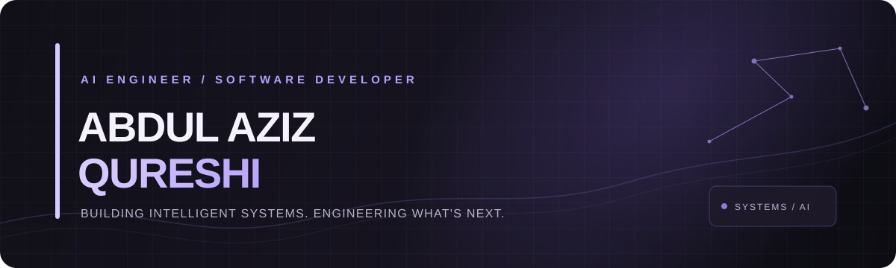

 

### Building practical software across AI, automation, and systems engineering.

---

## About

I’m **Abdul Aziz Qureshi**, an AI engineer and software developer interested in turning ideas into reliable, useful systems.

My work spans AI-powered applications, backend development, automation, computer vision, and embedded projects. I enjoy understanding how systems work beneath the interface — from architecture and data flow to reliability and security.

## Featured work

<table>
  <tr>
    <td width="100%">
      <h3>KAIRON · AI Site Reliability Engineering</h3>
      
<strong>A Windows-focused, local-first platform for software reliability and incident response.</strong>

      
KAIRON brings application telemetry, incident detection, investigation, AI-assisted diagnosis, and approval-controlled remediation into one workflow. The goal is to help developers understand failures and act on them with greater confidence.

      

        <a href="https://github.com/Azzy-Glitch/Kairon">Project overview ↗</a>
        &nbsp;·&nbsp; Repository is private
      

      Observability · Incident management · AI-assisted diagnosis · Controlled remediation · Windows
    </td>
  </tr>
</table>

## Selected projects

| Project | What it explores |
|---|---|
| [Nexus](https://github.com/Azzy-Glitch/PyFusion/tree/main/Nexus) | A Python-based desktop assistant combining voice interaction and automation. |
| [AiFusionLab](https://github.com/Azzy-Glitch/AiFusionLab) | Experiments and implementations across AI and machine learning. |
| [PyFusion](https://github.com/Azzy-Glitch/PyFusion) | Python applications, utilities, and automation projects. |
| [CppFusion](https://github.com/Azzy-Glitch/CppFusion) | C++ programming projects and practical development exercises. |
| [ArduinoCore](https://github.com/Azzy-Glitch/ArduinoCore) | Embedded development and Arduino-based hardware projects. |

## Engineering interests

- AI engineering and intelligent applications
- Software architecture and backend systems
- Site reliability engineering and developer tooling
- Computer vision and automation
- Embedded systems and hardware-software integration

## Current direction

Exploring how AI can move beyond answering questions to help developers **understand complex failures, uncover root causes, and improve software reliability**.

---

**BUILD · EXPLORE · ENGINEER**

Turning ideas into systems that work.

