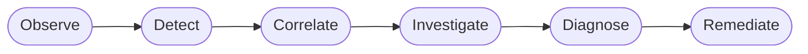

<!-- ============================== HEADER ============================== -->

 

  

<code>PYTHON</code> &nbsp;·&nbsp; <code>C++</code> &nbsp;·&nbsp; <code>C# / .NET</code> &nbsp;·&nbsp; <code>ARTIFICIAL INTELLIGENCE</code> &nbsp;·&nbsp; <code>AUTOMATION</code> &nbsp;·&nbsp; <code>SOFTWARE ENGINEERING</code>

 

---

<!-- ============================== ABOUT ============================== -->
## `01` &nbsp;/&nbsp; About

I'm **Abdul Aziz Qureshi**, an AI engineer and software developer building intelligent, practical, and reliable software systems. My work sits at the intersection of **software engineering, AI, automation, and embedded technologies**, with a focus on understanding how systems actually operate rather than stopping at surface-level implementation.

<table>
  <tr>
    <td width="50%" valign="top">

**What drives my work**

- Practical software in Python, C++, and C#/.NET
- AI, machine learning, and computer vision
- Automation tools and intelligent applications
- System architecture and software reliability
- Embedded systems and hardware integration

</td>
    <td width="50%" valign="top">

**Engineering direction**

- **Intelligent Engineering** — applying AI to real technical problems
- **Software Reliability** — understanding behaviour, preventing failures
- **Automation** — removing repetitive work with intelligent systems
- **AI & Robotics** — connecting machine intelligence to the physical world
- **System Architecture** — maintainable solutions, deliberate decisions

</td>
  </tr>
</table>

---

<!-- ============================== FLAGSHIP ============================== -->
## `02` &nbsp;/&nbsp; Flagship Project

# KAIRON
**AI Site Reliability Engineering Platform**

*Understand failures. Investigate evidence. Prevent what comes next.*

KAIRON is a **Windows-focused, local-first AI Site Reliability Engineering platform** that helps developers and teams understand, investigate, and respond to software reliability problems. Instead of treating monitoring and incident response as disconnected activities, it unifies application telemetry, system visibility, incident intelligence, AI-assisted investigation, and controlled remediation into a single workflow.

| Capability | Purpose |
|:---|:---|
| **Observability** | Understand application and system behaviour. |
| **Incident Detection** | Identify abnormal behaviour and operational failures. |
| **Correlation** | Connect related signals to understand broader problems. |
| **Investigation** | Use telemetry and evidence to investigate root causes. |
| **AI-Assisted Diagnosis** | Support technical investigation with AI-driven analysis. |
| **Controlled Remediation** | Execute approved recovery actions with safeguards. |

> **The bigger vision:** move beyond reporting *that* something failed. Help developers understand *why* it failed, surface hidden weaknesses, and identify potential failures before they reach users.

  

---

<!-- ============================== PROJECTS ============================== -->
## `03` &nbsp;/&nbsp; Selected Projects

| Project | Engineering Focus |
|:---|:---|
| [**Nexus**](https://github.com/Azzy-Glitch/PyFusion/tree/main/Nexus) | Voice interaction, desktop assistance, and automation. |
| [**AiFusionLab**](https://github.com/Azzy-Glitch/AiFusionLab) | Artificial intelligence and machine learning experiments. |
| [**PyFusion**](https://github.com/Azzy-Glitch/PyFusion) | Python applications, utilities, and automation. |
| [**CppFusion**](https://github.com/Azzy-Glitch/CppFusion) | C++ programming, algorithms, and engineering fundamentals. |
| [**ArduinoCore**](https://github.com/Azzy-Glitch/ArduinoCore) | Embedded development, hardware experiments, and automation. |

---

<!-- ============================== TOOLKIT ============================== -->
## `04` &nbsp;/&nbsp; Engineering Toolkit

<table>
  <tr>
    <td align="center" width="25%"><b>Languages</b></td>
    <td></td>
  </tr>
  <tr>
    <td align="center"><b>AI &amp; Vision</b></td>
    <td>  </td>
  </tr>
  <tr>
    <td align="center"><b>Backend &amp; Engineering</b></td>
    <td></td>
  </tr>
  <tr>
    <td align="center"><b>Embedded &amp; Automation</b></td>
    <td>  </td>
  </tr>
</table>

---

<!-- ============================== FOOTER ============================== -->

<samp>THE NEXT IDEA STARTS HERE.</samp>

## BUILD. &nbsp;BREAK. &nbsp;UNDERSTAND. &nbsp;REBUILD.

*Think beyond limitations. Engineer beyond expectations.*

**Turning curiosity into code. Ideas into innovation. Challenges into solutions.**

 

