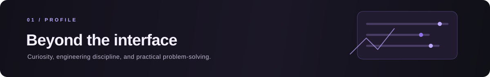
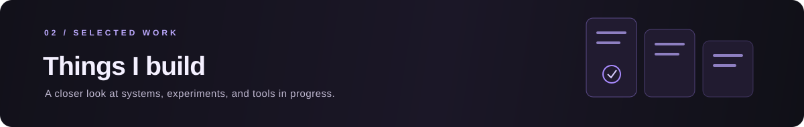
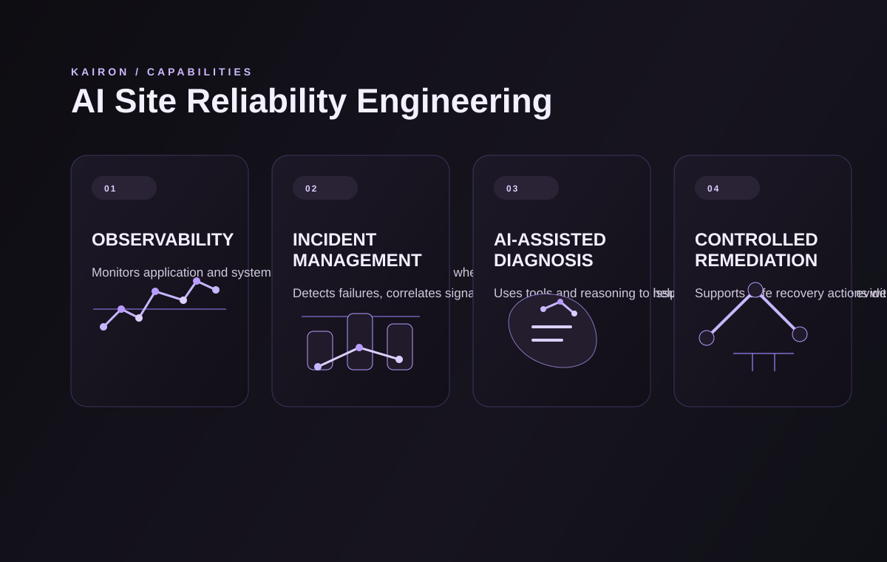
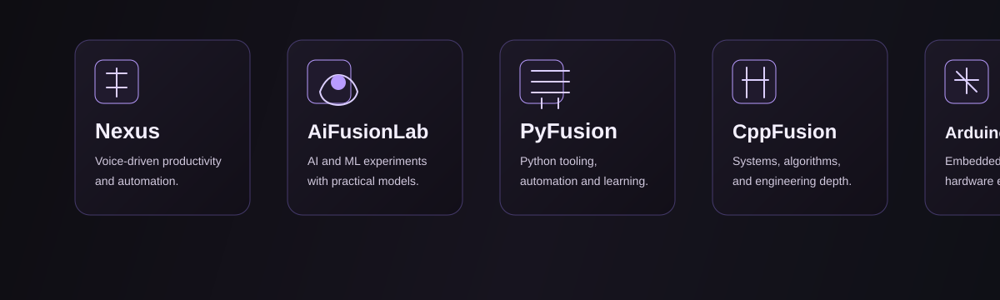
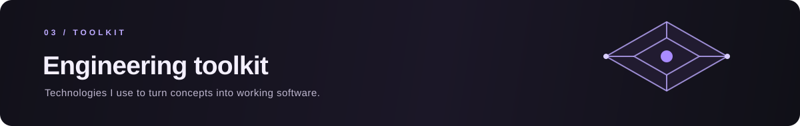
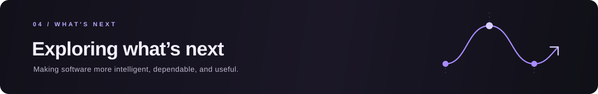

### AI Engineer | Software Developer

Building practical software systems that combine AI, automation, and reliable engineering.

---

### About me

I’m Abdul Aziz Qureshi, an AI engineer and software developer focused on building practical systems that connect machine intelligence with real-world engineering problems.

My work spans Python and C++, AI and machine learning, automation, computer vision, backend systems, and embedded development. I enjoy solving technical problems by understanding the system beneath the interface and turning ideas into tools that are useful, reliable, and maintainable.

---

### Featured project

## KAIRON — AI Site Reliability Engineering Platform

KAIRON is a Windows-focused, local-first platform for improving software reliability through observability, incident detection, investigation, and controlled recovery.

It helps teams understand what is failing, correlate application and system signals, investigate the evidence behind an issue, and execute safe, reviewable remediation when needed. The goal is not only to detect failure, but to support faster and more informed operational decisions.

### Core capabilities

- Application and system observability
- Incident detection and correlation
- Evidence-based investigation
- AI-assisted diagnosis
- Approval-controlled remediation
- Reliability monitoring and failure prevention

[Project overview ↗](https://github.com/Azzy-Glitch/Kairon)

---

### Other projects

| Project | Focus |
|---|---|
| [Nexus](https://github.com/Azzy-Glitch/PyFusion/tree/main/Nexus) | Python desktop assistant combining voice interaction and automation. |
| [AiFusionLab](https://github.com/Azzy-Glitch/AiFusionLab) | Machine learning and AI experiments focused on practical model development and prediction workflows. |
| [PyFusion](https://github.com/Azzy-Glitch/PyFusion) | Python projects, utilities, and practical problem-solving across automation and software work. |
| [CppFusion](https://github.com/Azzy-Glitch/CppFusion) | C++ projects focused on algorithms, data structures, and core engineering fundamentals. |
| [ArduinoCore](https://github.com/Azzy-Glitch/ArduinoCore) | Embedded systems and Arduino-based hardware experiments with sensors, control, and automation. |

---

### Engineering toolkit

#### Programming

#### AI & intelligent systems

#### Software engineering

#### Embedded & hardware

---

Exploring intelligent software systems, AI-assisted engineering, automation, software reliability, and practical problem-solving that connects software with real operational needs.

<strong>BUILD · EXPLORE · ENGINEER</strong>

Turning ideas into systems that work.

---

### Contact

[GitHub](https://github.com/Azzy-Glitch) · [LinkedIn](https://www.linkedin.com/in/azzy-glitch/) · [Email](mailto:abdulazizqureshi227@gmail.com)

