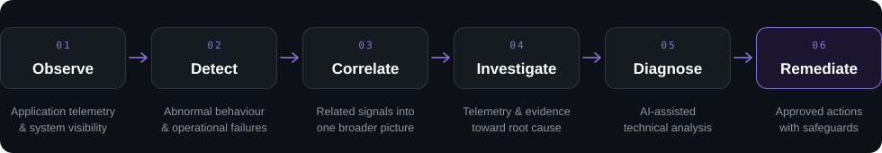
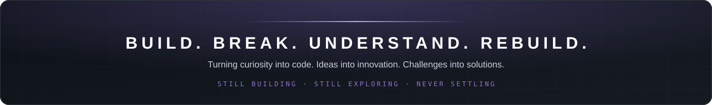

 

  

<a href="#about">About</a> &nbsp;·&nbsp;
<a href="#flagship-project">Flagship</a> &nbsp;·&nbsp;
<a href="#selected-projects">Projects</a> &nbsp;·&nbsp;
<a href="#engineering-toolkit">Toolkit</a> &nbsp;·&nbsp;
<a href="#contact">Contact</a>

 

| Applied AI | Software Engineering | Reliability & Automation |
|:---|:---|:---|
| Machine learning, computer vision, and AI-assisted tooling. | Python, C++, and C#/.NET with an architecture-first mindset. | Systems that observe, explain, and recover from failure. |

## About

I'm **Abdul Aziz Qureshi**, an AI engineer and software developer building intelligent, practical, and reliable software systems. My work sits at the intersection of software engineering, artificial intelligence, automation, and embedded technologies. I go beyond surface-level implementation: understanding how systems operate, identifying the engineering challenges, and turning ideas into functional solutions.

<table>
  <tr>
    <td width="50%" valign="top">

**What drives my work**

- Practical software in Python, C++, and C#/.NET
- AI, machine learning, and computer vision
- Automation tools and intelligent applications
- System architecture and software reliability
- Embedded systems and hardware integration

</td>
    <td width="50%" valign="top">

**Engineering direction**

- **Intelligent Engineering:** applying AI to real technical problems
- **Software Reliability:** understanding behaviour, preventing failures
- **Automation:** removing repetitive work with intelligent systems
- **AI & Robotics:** connecting machine intelligence to practical applications
- **System Architecture:** maintainable solutions, deliberate decisions

</td>
  </tr>
</table>

> The objective is simple: build things that solve actual problems, understand how they work, and make them better.

## Flagship Project

# KAIRON
**AI Site Reliability Engineering Platform**

*Understand failures. Investigate evidence. Prevent what comes next.*

 

 

KAIRON is a **Windows-focused, local-first AI Site Reliability Engineering platform** that helps developers and software teams understand, investigate, and respond to reliability problems. Rather than treating monitoring and incident response as disconnected activities, it brings application telemetry, system visibility, incident intelligence, AI-assisted investigation, and controlled remediation into one workflow.

| Capability | Purpose |
|:---|:---|
| **Observability** | Understand application and system behaviour. |
| **Incident Detection** | Identify abnormal behaviour and operational failures. |
| **Correlation** | Connect related signals to understand broader problems. |
| **Investigation** | Use telemetry and evidence to investigate root causes. |
| **AI-Assisted Diagnosis** | Support technical investigation with AI-driven analysis. |
| **Controlled Remediation** | Execute approved recovery actions with safeguards. |

**Design principles**

- **Local-first:** built around the developer's own Windows environment.
- **Evidence over guesswork:** diagnoses grounded in telemetry and correlated signals.
- **Controlled by design:** remediation limited to approved actions, with safeguards.

> **The bigger vision:** move beyond reporting *that* something failed. Help developers understand *why* it failed, surface hidden weaknesses, and identify potential failures before they affect users.

  

## Selected Projects

| Project | Engineering focus | Domain |
|:---|:---|:---|
| **[Nexus](https://github.com/Azzy-Glitch/PyFusion/tree/main/Nexus)** | Voice interaction, desktop assistance, and automation. | `Voice` `Desktop` `Automation` |
| **[AiFusionLab](https://github.com/Azzy-Glitch/AiFusionLab)** | Artificial intelligence and machine learning experiments. | `AI` `ML` |
| **[PyFusion](https://github.com/Azzy-Glitch/PyFusion)** | Python applications, utilities, and automation. | `Python` `Automation` |
| **[CppFusion](https://github.com/Azzy-Glitch/CppFusion)** | C++ programming, algorithms, and engineering fundamentals. | `C++` `Algorithms` |
| **[ArduinoCore](https://github.com/Azzy-Glitch/ArduinoCore)** | Embedded development, hardware experiments, and automation. | `Arduino` `Embedded` |

## Engineering Toolkit

<table>
  <tr>
    <td align="center" width="26%"><b>Languages</b></td>
    <td></td>
  </tr>
  <tr>
    <td align="center"><b>AI &amp; Vision</b></td>
    <td>  </td>
  </tr>
  <tr>
    <td align="center"><b>Backend &amp; Tooling</b></td>
    <td></td>
  </tr>
  <tr>
    <td align="center"><b>Embedded &amp; Automation</b></td>
    <td>  </td>
  </tr>
</table>

## Contact

Interested in AI engineering, software reliability, or automation? Let's talk.

  

